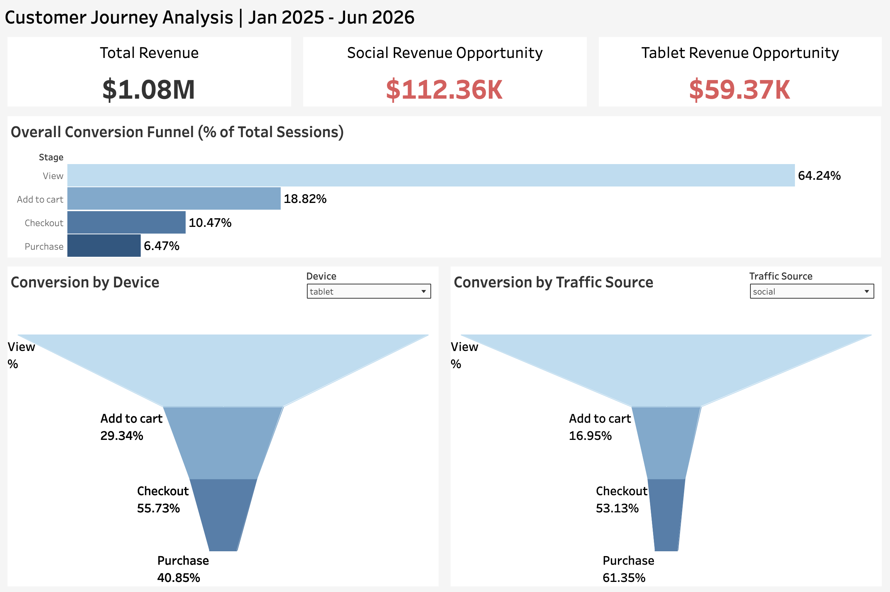
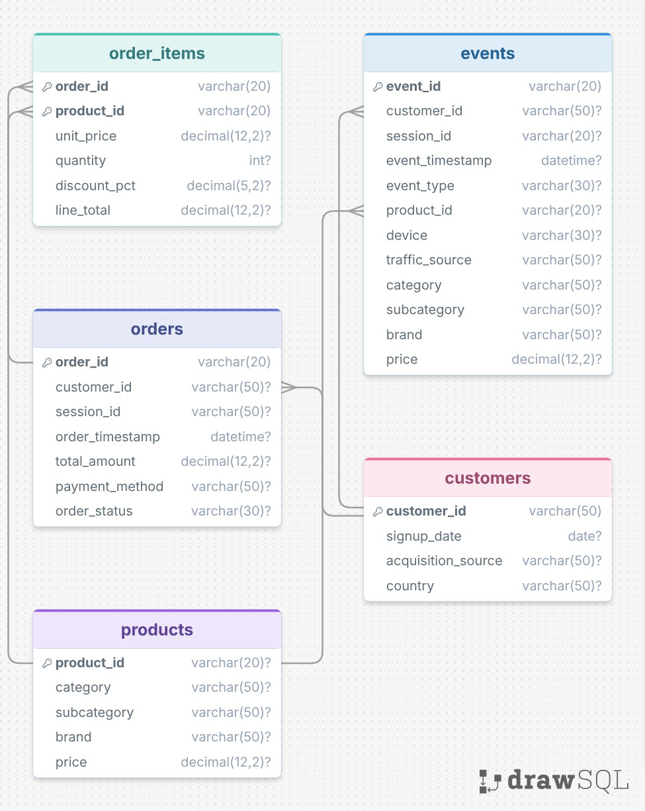

# E-Commerce Funnel Analysis 

## Executive Summary
Order conversion has been down at our ecommerce company, and we need to investigate potential friction points in the customer journey and identify potential solutions. By generating and cleaning synthetic event data using Python, architecting a relational database using SQL, and building an interactive Tableau dashboard, I identified two major friction points: Tablet checkout flows and Social traffic acquisition. Fixing these drop-offs represents a combined **$171.73K in potential lost revenue**. Based on these findings, the recommended areas of focus are:

*   **Optimize Mobile Checkout:** The Tablet checkout-to-purchase conversion (40.9%) lags significantly behind the Desktop/Mobile benchmark (65.2%). Prioritize checkout UX testing on tablet viewports.
*   **Audit Social Landing Pages:** Social traffic suffers from severe top-of-funnel friction. The Social View-to-Cart rate is only 16.9%, compared to the overall average of 29.3%. 
*   **Implement Targeted Retargeting:** Capture the $112.3K opportunity from Social traffic by implementing abandoned cart retargeting campaigns specifically for users acquired via social channels.

## Business Problem
E-commerce businesses need to understand how effectively website visitors progress from product discovery to completed purchases. A high volume of traffic does not necessarily translate into revenue if customers encounter friction at particular stages of the purchase journey.

The objective of this project was to analyze the e-commerce conversion funnel and answer the following questions:

1. How many sessions progress through each stage of the purchase funnel?
2. Where are the largest conversion drop-offs?
3. How does funnel performance differ across devices?
4. How does funnel performance differ across traffic sources?
5. What is the potential business impact of improving conversion rates in underperforming segments?

The analysis focuses on four sequential funnel stages:

View → Add to Cart → Checkout → Purchase

## Methodology

1.  **Database Architecture:** Designed a 5-table relational schema (`customers`, `products`, `orders`, `order_items`, `events`) in MySQL. 
2.  **Data Generation & Cleaning:** Utilized Python to generate 200K+ realistic event logs and transaction records, then cleaned and prepped the data for analysis. ([View Notebooks](data_generation.ipynb))
3.  **Funnel Logic & SQL Analysis:** Built strict sequential funnel queries using CTEs and window functions (`ROW_NUMBER`) to track user progression from View → Add to Cart → Checkout → Purchase. ([View SQL](business_impact.sql))
4.  **Business Impact Modeling:** Developed a benchmarking model that compares underperforming segments (Tablets, Social) against the top-performing baseline (Desktop/Mobile) to calculate "Expected Purchases" and the resulting lost revenue (based on an Overall AOV of $45.10).
5.  **Data Visualization:** Built an interactive executive dashboard in Tableau to visualize the overall funnel and segment-level friction points.

## Skills 
*   **Data Architecture:** Relational Database Design (ERD), MySQL DDL (Primary/Foreign Keys, Constraints).
*   **Programming and Data Analysis:** Python (pandas), data generation and manipulation, data auditing and cleaning
*   **SQL:** Multi-level CTEs, Window Functions (`ROW_NUMBER`), Self-Joins, Strict Funnel Logic, Aggregations, Benchmarking Analysis.
*   **Business Impact Analysis:** Revenue attribution, Opportunity Sizing, AOV calculations, segment performance analysis
*   **Data Visualization:** Tableau (LOD calculations, interactive parameters, UI/UX layout design).

## Results and Business Recommendations

### 1. The Tablet Revenue Gap ($59.37K Opportunity)
*   **The Finding:** Tablet users face significant friction at the final step. Only **40.85%** of tablet users who reach checkout complete a purchase, compared to the pooled Desktop/Mobile benchmark of **65.21%**.
*   **The Impact:** If Tablets converted at the benchmark rate, the platform would capture an additional **1,316 purchases**, equating to **$59,370** in missed revenue (based on $45.10 AOV).
*   **Recommendation:** Conduct QA testing on the tablet checkout interface, specifically looking at payment gateway rendering, page responsiveness, and form field usability on iOS/Android tablets.

### 2. The Social Traffic Revenue Gap ($112.36K Opportunity)
*   **The Finding:** Social traffic has a severe top-of-funnel issue. The View-to-Cart conversion for Social is **16.95%**, compared to the Non-Social benchmark of **29.34%**. However, once they reach checkout, Social users convert at a healthy 61.35% (comparable to the overall 61.79%).
*   **The Impact:** Aligning Social's View-to-Cart rate with the benchmark would yield an additional **2,492 purchases**, equating to **$112,360** in missed revenue.
*   **Recommendation:** Investigate the social acquisition journey, including the quality and intent of incoming traffic, the relevance of landing pages, and the consistency between ads and product offerings. Improving the alignment between social campaigns and the on-site shopping experience may help more visitors progress to the cart stage.

*(View the full interactive Tableau Dashboard [here](https://public.tableau.com/app/profile/bryant.cortez/viz/FunnelAnalysis_17933177896900/FunnelAnalysisDashboard?publish=yes) or download the `.twbx` file in this repo).*

## Next Steps
*   **Cohort Analysis:** Analyze the Social traffic drop-off over time to see if specific campaigns or months performed worse.
*   **Product-Level Friction:** Expand the SQL queries to identify if specific product categories (e.g., Electronics vs. Apparel) drive higher tablet abandonment.
*   **A/B Testing:** Implement a mobile/tablet-specific checkout UI test (e.g., Apple Pay/Google Pay integrations) to validate the $59.37K recovery hypothesis.

## Limitations and Assumptions
*   **Synthetic Data:** The dataset was generated via Python to simulate realistic e-commerce behavior. While the logic and SQL queries are production-ready, the specific dollar amounts are hypothetical and may not reflect real-world business outcomes.
*   **Device Attribution:** A session's device is attributed based on the user's *first* event (the "View"). If a user viewed a product on a tablet but later purchased on a desktop, it is counted as a tablet session.
*   **Constant AOV:** The lost revenue calculation uses the overall Average Order Value ($45.10). In reality, different traffic sources or devices may have varying AOVs, which could shift the exact dollar impact.
*   **No Causal Analysis:** The analysis identifies differences in conversion performance but does not establish why those differences occur. Further investigation and controlled experiments would be needed to identify causal factors.
